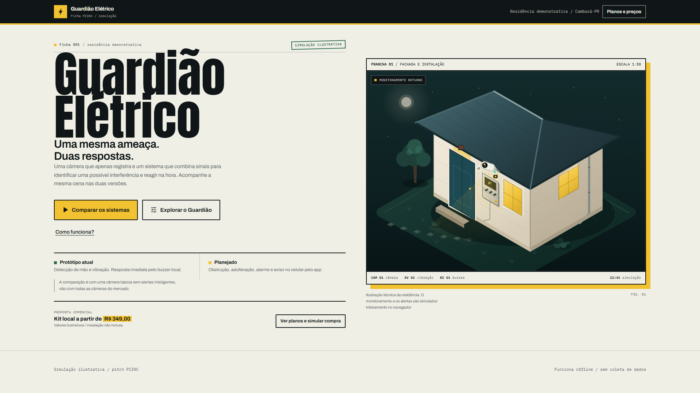
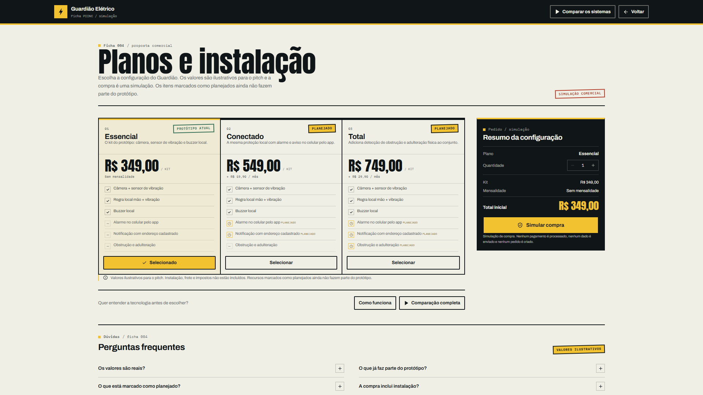

# Guardião Elétrico — Simulação interativa

Site de demonstração para o pitch **PIINC**: a mesma ameaça, duas respostas. A experiência compara uma câmera básica, que apenas registra, com o Guardião Elétrico, que combina câmera e sensor de vibração para identificar uma possível interferência e reagir localmente.

A ilustração é 2.5D/isométrica, feita em SVG, e toda a interação roda no navegador. Não há API, autenticação, imagens remotas nem envio de notificações reais.

**Site publicado:** https://alfredo-cmd.github.io/guardiao-eletrico-site/



## O que a demonstração inclui

- **Sequência guiada (~68 s)** com a mesma cena e a mesma trajetória nas duas versões.
- **Câmera básica:** gravação, visão obstruída e a mensagem “registro não é resposta imediata”.
- **Guardião:** mão detectada + vibração detectada → buzzer local, com a regra exibida em tempo real. O alarme também pode tocar no celular pelo app (planejado).
- **Modo Explorar:** ligue e desligue mão, vibração, obstrução, adulteração e alarme no celular para ver a lógica responder.
- **Como o Guardião pensa?:** painel interativo com a porta lógica `mão E vibração` e as ramificações planejadas.
- **Planos e simulação de compra:** três configurações, valores ilustrativos e uma ficha de pedido que não processa pagamentos.
- **Alarme no celular** pelo app, exibido junto do buzzer local, e **notificação simulada** com tipo de evento, horário e localização cadastrada (sem GPS e sem envio real).
- **Resumo final** com as duas respostas e a frase de fechamento do pitch.
- Controles de pausa, etapa anterior/próxima, reinício, som e tela cheia.

## Stack

- React 18 + TypeScript + Vite 6
- Tailwind CSS 4
- Motion para transições
- Lucide para ícones
- SVG autoral para a casa, o personagem e os efeitos
- Fontes locais: Anton (display), Archivo Variable (texto/interface) e IBM Plex Mono (dados técnicos), via `@fontsource`

## Direção visual

A interface foi reformulada como um **laudo de campo / prancha técnica**: papel cru, tinta preta, amarelo de sinalização e vermelho de alerta. A casa é uma ilustração noturna em SVG dentro de uma prancha com moldura, códigos de equipamento e legenda; o simulador usa um painel de instrumentos escuro ao lado da prancha. A tipografia combina Anton para títulos, Archivo para leitura e IBM Plex Mono apenas para leituras e códigos.

## Planos e simulação de compra

A ficha **004 / proposta comercial** apresenta três configurações:

| Plano | Kit | Mensalidade | Situação |
| --- | ---: | ---: | --- |
| Essencial | R$ 349,00 | — | protótipo atual |
| Conectado | R$ 549,00 | R$ 19,90 | inclui recursos planejados |
| Total | R$ 749,00 | R$ 29,90 | inclui obstrução e adulteração planejadas |

Os valores são **ilustrativos para o pitch** e podem ser alterados em `src/data/plans.ts`. O fluxo de compra é uma simulação: escolhe plano, quantidade e forma de pagamento fictícia, mas **não coleta dados, não processa pagamento e não cria pedido**. A confirmação mostra apenas um código de demonstração.



## Skills do agente

O projeto inclui a skill **`frontend-design`** em `.opencode/skills/frontend-design/`, copiada de [anthropics/skills](https://github.com/anthropics/skills/tree/main/skills/frontend-design) e licenciada sob Apache 2.0 (termos em `LICENSE.txt`).

O OpenCode descobre skills de projeto automaticamente em `.opencode/skills`. Para acioná-la, peça para usar a skill `frontend-design` ou mencione `@frontend-design`. Ela é uma ferramenta de desenvolvimento e não faz parte do bundle publicado em `docs/`.

## Rodar o projeto

Requisitos: Node.js 20 ou superior.

```bash
npm install
npm run dev
```

O Vite abre o endereço local, normalmente `http://localhost:5173`.

### Build de produção

```bash
npm run build
npm run preview
```

O build usa `vite-plugin-singlefile`: **`dist/index.html` é autossuficiente** e pode ser aberto diretamente pelo navegador (duplo clique), sem servidor e sem internet. Isso é útil para apresentar o pitch em qualquer computador.

A versão publicada é gerada a partir de `dist/index.html`, `dist/robots.txt` e `dist/sitemap.xml`, copiados para `docs/` e servidos pelo GitHub Pages em `/docs`.

### Links diretos

A navegação usa hash routing, então cada tela tem uma URL compartilhável e o botão Voltar do navegador funciona:

| Tela | URL |
| --- | --- |
| Início | `#/` |
| Comparação guiada | `#/comparar` |
| Explorar sinais | `#/explorar` |
| Como funciona | `#/como-funciona` |
| Planos e compra | `#/planos` |

## Controles

- **Comparar os sistemas:** inicia a sequência guiada automaticamente.
- **Explorar o Guardião:** abre o modo manual com os sinais.
- **Como funciona?:** abre o painel explicativo interativo.
- **Planos e preços:** abre a proposta comercial e a simulação de compra.
- **Som:** começa desligado; o áudio só é criado após o clique no botão.
- **Tela cheia:** disponível no cabeçalho do simulador.

Atalhos durante a sequência guiada:

| Tecla | Ação |
| --- | --- |
| `Espaço` | Pausar / continuar |
| `←` / `→` | Etapa anterior / próxima |
| `R` | Reiniciar demonstração |
| `M` | Ligar / desligar som |

## Estrutura

```
src/
  app/App.tsx                  # troca de telas e transições
  screens/
    HomeScreen.tsx             # tela inicial
    SimulatorScreen.tsx        # comparação guiada + modo explorar
    HowItWorksScreen.tsx       # painel "Como o Guardião pensa?"
    PricingScreen.tsx          # planos e simulação de compra
  components/
    HouseScene.tsx             # ilustração isométrica e estados visuais
    Character.tsx              # personagem 2.5D
    PhoneNotification.tsx      # notificação fictícia
    PurchaseOverlay.tsx        # ficha de pedido simulada
    SensorPanel.tsx            # painel de sinais
    PlaybackControls.tsx       # controles e linha do tempo
    ComparisonSelector.tsx     # capítulos da comparação
    ExplainerFlow.tsx          # regra interativa (E lógico)
    SummaryOverlay.tsx         # resumo final
    Brand.tsx
  data/scenes.ts               # roteiro declarativo + lógica do modo explorar
  data/plans.ts                # planos, preços e recursos comerciais
  hooks/
    useSimulation.ts           # máquina de estados e autoplay
    useSound.ts                # WebAudio, sem arquivos externos
    useFullscreen.ts
    useFitAspect.ts            # encaixe 1000×720 da cena
  lib/iso.ts                   # projeção isométrica
  styles/globals.css           # tokens, componentes e animações
```

## Integridade da demonstração

A simulação diferencia claramente o que é protótipo do que é planejado:

- **Protótipo atual:** detecção de mão por visão computacional, sensor de vibração, regra combinada e buzzer local.
- **Planejado:** obstrução da câmera, adulteração física, alarme e notificação no celular, localização cadastrada e infraestrutura de comunicação. Obstrução e adulteração também têm o alarme como consequência, mas a lógica ainda não está implementada.
- Nenhuma chamada de emergência ou notificação real é disparada.
- O fluxo de compra é inteiramente simulado: nenhum pagamento é processado, nenhum dado é coletado e nenhum pedido real é criado.
- O endereço usado é fictício (`Cambará/PR`) e não há coleta de dados.
- A comparação é com uma **câmera básica sem alertas inteligentes**, não com todas as câmeras do mercado.

## Acessibilidade e apresentação

- Textos em português brasileiro, legendas sempre visíveis e contraste alto.
- Controles com `aria-pressed`, `aria-checked` e regiões `aria-live` para as legendas.
- Respeito a `prefers-reduced-motion` no CSS e nas transições via `MotionConfig`.
- Link **Pular para o conteúdo**, foco visível e foco preso nos overlays de resumo e compra.
- Navegação por hash com links compartilháveis e botões Voltar/Avançar do navegador.
- Ilustração com `aria-hidden`; a narrativa está sempre no texto.
- Layout pensado para projetor 1920×1080, com adaptação para celular.
- Lighthouse **100** em acessibilidade, boas práticas e SEO nas telas principais (início, simulador e planos).

## Limitações

Esta é uma simulação ilustrativa. Obstrução de câmera exige tratamento de iluminação, perda de sinal e falsos positivos; adulteração física pode exigir sensores dedicados. O sistema detecta sinais de possível interferência — não impede todos os furtos nem identifica pessoas.
